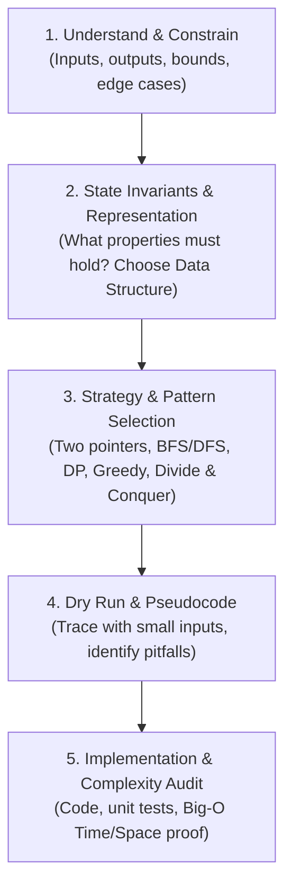

# Algorithms & Data Structures Lab

Interactive learning laboratory for mastering foundational Computer Science algorithms and data structures through a rigorous, first-principles thinking framework.

Implementations are dual-coded in **Rust** (systems-level memory, ownership, zero-cost abstractions) and **TypeScript / Bun** (high-level typing, runtime analysis, rapid prototyping).

---

## The 5-Step Algorithmic Thinking Framework

Every problem and data structure in this repository is tackled using this mental pipeline:



1. **Understand & Constrain**: Determine input scale ($N$), types, constraints, and target time/space complexity budget.
2. **State Invariants & Representation**: Select the optimal data structure based on access and mutation trade-offs.
3. **Strategy & Pattern Selection**: Identify the pattern (e.g. Two Pointers, Sliding Window, Monotonic Stack, Backtracking, DP).
4. **Interactive Dry Run**: Step-by-step trace with small inputs and edge cases before writing code.
5. **Dual Implementation & Complexity Audit**: Implement in Rust and TypeScript, verify with unit tests, and prove Big-$O$ Time and Space complexities.

---

## Quick Start & Running Tests

### Rust (Cargo Workspace)
Run all tests across all modules:
```bash
cargo test
```
Run tests for a specific topic (e.g., Arrays & Strings):
```bash
cargo test -p arrays_and_strings
```

### TypeScript / Bun
Run all tests across all modules:
```bash
bun test
```
Run tests for a specific topic:
```bash
bun test topics/01_arrays_and_strings/ts
```

---

## Curriculum & Progress Tracker

| # | Topic | Key Concepts | Rust Status | TS/Bun Status |
|---|-------|--------------|:-----------:|:-------------:|
| **01** | [Arrays & Strings](file:///home/manuel/Documents/labs/algorith_data_structures/topics/01_arrays_and_strings) | Memory layout, Two Pointers, Sliding Window, Prefix Sums | 🔄 Ready | 🔄 Ready |
| **02** | [Linked Lists](file:///home/manuel/Documents/labs/algorith_data_structures/topics/02_linked_lists) | Pointers, ownership/boxes, Fast & Slow Pointers, Reversal | 🔄 Ready | 🔄 Ready |
| **03** | [Stacks & Queues](file:///home/manuel/Documents/labs/algorith_data_structures/topics/03_stacks_and_queues) | LIFO/FIFO, Monotonic Stacks, Circular Queues, Deques | 🔄 Ready | 🔄 Ready |
| **04** | [Hash Tables](file:///home/manuel/Documents/labs/algorith_data_structures/topics/04_hash_tables) | Hash functions, collision resolution, frequency maps | 🔄 Ready | 🔄 Ready |
| **05** | [Searching & Sorting](file:///home/manuel/Documents/labs/algorith_data_structures/topics/05_searching_and_sorting) | Binary Search on Answer, QuickSort, MergeSort, Invariants | 🔄 Ready | 🔄 Ready |
| **06** | [Trees & Heaps](file:///home/manuel/Documents/labs/algorith_data_structures/topics/06_trees_and_heaps) | Binary Trees, BSTs, Traversals, Heaps / Priority Queues | 🔄 Ready | 🔄 Ready |
| **07** | [Graphs](file:///home/manuel/Documents/labs/algorith_data_structures/topics/07_graphs) | Adjacency representation, BFS, DFS, Topological Sort, Dijkstra | 🔄 Ready | 🔄 Ready |
| **08** | [Dynamic Programming](file:///home/manuel/Documents/labs/algorith_data_structures/topics/08_dynamic_programming) | Memoization, Tabulation, Subproblem DAG, Space Optimization | 🔄 Ready | 🔄 Ready |
