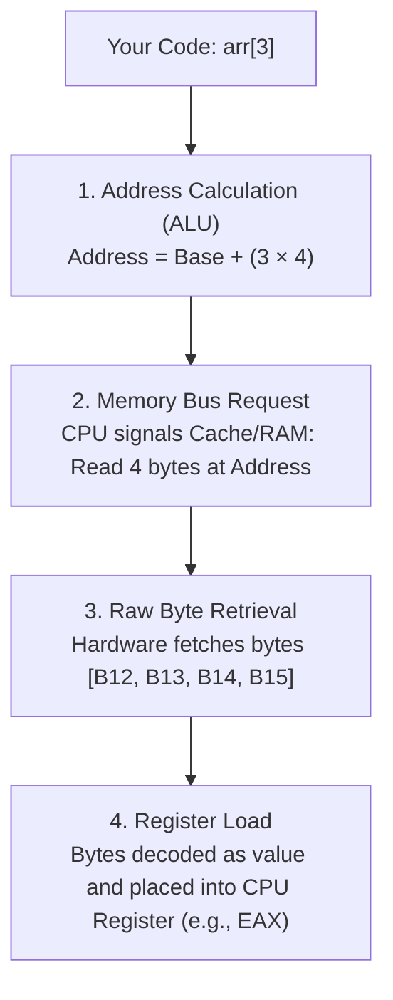

# Memory Layout, Address Calculation & Hardware Reality of Arrays

Understanding how an array exists physically in hardware is the single most important foundation for mastering Data Structures and Algorithms. It explains **why** operations have their respective Big-$O$ costs, rather than treating them as arbitrary rules to memorize.

---

## 1. Physical RAM as a Byte-Addressable Street

Computer memory (RAM) is architected as an enormous, linear sequence of **1-byte mailboxes**. Every mailbox holds **8 bits** of data and possesses a unique, sequential numerical address (commonly represented in hexadecimal, e.g., `0x1000`).

```
Address:    0x1000  0x1001  0x1002  0x1003  0x1004  0x1005  0x1006  0x1007
Byte:      [  B0  ][  B1  ][  B2  ][  B3  ][  B4  ][  B5  ][  B6  ][  B7  ]
```

### The Definition of an Array
An array is a collection of elements that satisfy two strict physical constraints:
1. **Contiguous**: Elements are stored in consecutive, unbroken memory addresses.
2. **Homogeneous (Uniform Size)**: Every element occupies the exact same number of bytes ($S$).

---

## 2. Element Size ($S$) and Primitive Types

Different types require different amounts of physical storage:

| Data Type | Rust Type | Typical C/C++ | TypeScript / JS Runtime | Size ($S$ in bytes) |
|---|---|---|---|:---:|
| Boolean / ASCII Byte | `bool`, `u8`, `i8` | `char`, `bool` | Boolean (engine tagged) | **1** |
| 16-bit Integer | `i16`, `u16` | `short` | Small Integer (SMI) | **2** |
| 32-bit Integer / Float | `i32`, `u32`, `f32` | `int`, `float` | Small Integer (SMI) | **4** |
| 64-bit Integer / Float | `i64`, `u64`, `f64` | `long long`, `double` | JS `number` (IEEE 754 float) | **8** |
| Pointer / Memory Address | `usize`, `&T`, `*const T` | `uintptr_t`, `T*` | Object Reference (64-bit) | **8** |

---

## 3. The Address Calculation Formula

Because the elements are contiguous and uniform in size, calculating where any element lives in RAM is a pure algebraic calculation:

$$\text{Address}(i) = \text{Base Address} + (i \times S)$$

Where:
* **$\text{Base Address}$**: The physical RAM location of the very first element (`arr[0]`).
* **$i$ (Index / Offset)**: How many elements to skip from the beginning.
* **$S$ (Stride / Element Size)**: The byte width of each element.

### Visualizing an Array of Four 32-bit Integers (`i32`)
Let `let arr: [i32; 4] = [10, 20, 30, 40];` with $\text{Base Address} = 0x1000$ and $S = 4$:

```
Index:               arr[0]                 arr[1]                 arr[2]                 arr[3]
Value:                 10                     20                     30                     40
Physical Bytes:   [B0 B1 B2 B3]          [B4 B5 B6 B7]          [B8 B9 B10 B11]        [B12 B13 B14 B15]
Start Address:    0x1000                 0x1004                 0x1008                 0x100C
```

### Why Indexing is 0-Based
In computer systems, an **index is not an ordinal ranking ("1st, 2nd, 3rd")**. 
An index is an **offset distance**:
* `arr[0]` means: *"Go to Base Address, and offset by $0 \times S$ bytes."*
  $$\text{Address} = 0x1000 + (0 \times 4) = 0x1000$$
* `arr[1]` means: *"Go to Base Address, and offset by $1 \times S$ bytes."*
  $$\text{Address} = 0x1000 + (1 \times 4) = 0x1004$$
* `arr[2]` means: *"Go to Base Address, and offset by $2 \times S$ bytes."*
  $$\text{Address} = 0x1000 + (2 \times 4) = 0x1008$$

### Maximum Index & Bounds Calculation
For an array containing $N$ elements:
* **Valid Indices**: $0 \le i \le N - 1$
* **Max Index**: $N - 1$
* **Address of the Final Element**:
  $$\text{Address}(N - 1) = \text{Base Address} + ((N - 1) \times S)$$
* **Total Memory Footprint**:
  $$\text{Total Bytes} = N \times S$$
* **Address Immediately Past the Array** (One-past-the-end sentinel):
  $$\text{Past-End Address} = \text{Base Address} + (N \times S)$$

---

## 4. The Math Logic: Why Do We Multiply by $S$?

Why is the offset calculation a multiplication ($i \times S$) rather than addition ($i + S$) or any other operation?

### 4.1. Principle A: Multiplication as Repeated Addition
In basic arithmetic, multiplication is defined as **accumulating $i$ groups of size $S$**:
$$i \times S = \underbrace{S + S + \dots + S}_{i \text{ times}}$$

To reach element index `3` in memory, you must jump past all bytes of element 0, all bytes of element 1, and all bytes of element 2:

```
Byte Offset: 0     1     2     3  |  4     5     6     7  |  8     9    10    11  | 12
             [     arr[0]        ] [     arr[1]        ] [     arr[2]        ] [ arr[3] starts...
Jumps:       |--- Jump 1 (+4) ---|--- Jump 2 (+4) ---|--- Jump 3 (+4) ---|
```

$$\text{Bytes to skip} = 4 + 4 + 4 = 3 \times 4 = 12 \text{ bytes}$$

Because every element is guaranteed to be the exact same size ($S$), **multiplication is simply the shorthand for making $i$ equal jumps of $S$ bytes**.

### 4.2. Principle B: Dimensional Analysis (Unit Cancellation)
In mathematics and physics, you cannot add two values that have different units (e.g., you cannot add 3 apples and 4 meters). You can only convert units by **multiplying by a conversion factor** where matching units cancel out:

Look at the dimensional units:
* **`index`**: measured in **elements** (e.g., $3 \text{ elements}$)
* **`S`**: measured in **bytes per element** (e.g., $4 \frac{\text{bytes}}{\text{element}}$)

When you multiply them:
$$\text{Offset} = 3 \text{ elements} \times 4 \frac{\text{bytes}}{\text{element}} = (3 \times 4) \left( \frac{\cancel{\text{elements}} \times \text{bytes}}{\cancel{\text{elements}}} \right) = 12 \text{ bytes}$$

The unit **`element` cancels out completely**, leaving behind pure **`bytes`**!

> **Real-World Analogy (Hours to Minutes)**:
> If you have $3 \text{ hours}$, how many minutes is that?
> You know there are $60 \frac{\text{minutes}}{\text{hour}}$.
> You don't add $3 + 60 = 63$. You multiply:
> $$3 \text{ hours} \times 60 \frac{\text{minutes}}{\text{hour}} = 180 \text{ minutes}$$
> Each hour contains a bucket of 60 minutes. Likewise, each array slot contains a bucket of $S$ bytes.

### 4.3. Why Addition ($i + S$) Fails
If someone mistakenly computed $\text{Offset} = i + S = 3 + 4 = 7 \text{ bytes}$:
* Bytes $0-3$: hold `arr[0]`
* Bytes $4-7$: hold `arr[1]`
* Byte $7$ is the **very last byte of `arr[1]`**!
Adding lands you in the middle of element 1 instead of element 3, corrupting the data.

---

## 5. From Address to Value: The Hardware Lifecycle of `arr[i]`

What is the mechanical difference between getting the **address** and getting the **value**?

### The Locker Analogy
Imagine a row of identical lockers along a hallway:
* The entrance is at **0 feet** (**Base Address**).
* Each locker is **4 feet wide** (**Size $S = 4$**).
* Inside Locker 3 is a `"Camera"` (**The Value**).

```
Hallway:  0 ft            4 ft            8 ft            12 ft           16 ft
          |--- Locker 0 ---|--- Locker 1 ---|--- Locker 2 ---|--- Locker 3 ---|
Inside:   [   "Shoes"      ] [   "Books"    ] [   "Laptop"   ] [   "Camera"   ]
```

1. **Calculate distance**: The robot cart calculates: $3 \times 4 = 12\text{ ft}$.
2. **Move to coordinate**: The cart drives to foot 12 (**The Address** / Door coordinate).
3. **Extract content**: The cart opens the door and grabs the `"Camera"` (**The Value**).

### The Exact Silicon Sequence
When your program executes `let val = arr[3];`:



### CPU Assembly Reality
On modern x86-64 and ARM processors, this entire sequence is executed in a **single instruction**:
```nasm
mov eax, [rbx + rdi * 4]
```
* `rbx`: Base address of the array.
* `rdi`: Index $i$.
* `* 4`: Element size $S$ (scale factor).
* `[ ... ]`: Dereference brackets (meaning *"fetch the value stored at this address"*).
* `eax`: Destination register that receives the **Value**.

---

## 6. Why Array Lookup is $O(1)$ Constant Time

To access `arr[999_999]` in an array of one million integers, the CPU does **not** scan elements 0 through 999,998.

Instead, the CPU arithmetic logic unit (ALU) computes:
$$\text{Target} = \text{Base} + (999\,999 \times 4)$$
This requires **one multiplication** and **one addition**, which executes in a single CPU cycle ($\approx 0.3$ nanoseconds). Accessing the 1st element or the 1,000,000th element takes the exact same amount of time: **$O(1)$**.

---

## 5. CPU Cache Lines & Spatial Locality

CPUs do not read RAM byte-by-byte. Memory transfers between RAM and the CPU occur in chunks called **Cache Lines** (typically **64 bytes** wide).

```
RAM Transfer: [ 64 Contiguous Bytes fetched in one memory cycle ]
              ├── arr[0] ──┤├── arr[1] ──┤ ... ├── arr[15] ──┤
```

* When your code reads `arr[0]`, the CPU's memory controller automatically loads the entire 64-byte block into the ultra-fast **L1 Data Cache**.
* In an `i32` array ($4$ bytes per element), one 64-byte line holds **16 consecutive integers**.
* When your loop reaches `arr[1]`, `arr[2]`, ..., `arr[15]`, the CPU gets a **Cache Hit** (access latency $< 1$ ns) rather than waiting for main RAM ($50-100$ ns).
* This property is called **Spatial Locality**, and it is the primary reason contiguous arrays outperform linked lists or node trees by orders of magnitude on modern hardware.

---

## 6. Language Runtime Comparison: Rust vs. TypeScript / Bun

### Rust (Systems Reality)
```rust
// 1. Fixed Array: Allocated directly on the STACK
let fixed: [i32; 4] = [10, 20, 30, 40]; // 16 contiguous bytes on stack frame

// 2. Dynamic Vector: Heap buffer managed by a 3-word stack descriptor
let mut dynamic: Vec<i32> = vec![10, 20, 30, 40];
```

In 64-bit Rust, `Vec<T>` on the stack is exactly 24 bytes:
1. `ptr`: 8-byte pointer to heap memory where the contiguous buffer lives.
2. `capacity`: 8-byte integer (how many elements the buffer can hold before reallocating).
3. `len`: 8-byte integer (how many elements currently exist).

```
STACK                                HEAP (Contiguous Buffer)
[ ptr: 0x5000 | cap: 4 | len: 4 ] -> 0x5000: [ 10 | 20 | 30 | 40 ]
```

### TypeScript / JavaScript (Bun / V8 / JSC Reality)
In JavaScript engines (like JavaScriptCore in Bun or V8 in Node):
* Arrays are dynamic objects. The engine optimizes sequential numeric arrays into **Packed SMI (Small Integer)** or **Packed Double** internal C++ arrays.
* However, if you create sparse entries or mix data types:
  ```ts
  const arr = [1, 2, 3];
  arr[10000] = 99; // Introduces holes!
  ```
  The engine de-optimizes the array into **Dictionary Mode** (Hash Table lookup). Indexing degrades from $O(1)$ direct address arithmetic to hash table lookups with collisions and GC overhead.

---

## 7. Key Takeaways
1. **$O(1)$ Access**: Comes directly from the mathematical formula $\text{Base} + (i \times S)$.
2. **Offset Semantics**: Index $0$ is an offset of zero steps from base.
3. **Contiguity**: Enables hardware cache line prefetching (Spatial Locality).
4. **Insertion/Deletion Cost**: Inserting at index $0$ requires shifting all $N$ subsequent elements by $S$ bytes to preserve contiguity, making it **$O(N)$**.

---

## 8. Recommended Reading Materials

For an in-depth syllabus with exact section numbers, pages, and key takeaways, see the dedicated guide:
👉 **[00_recommended_readings_guide.md](file:///home/manuel/Documents/labs/algorith_data_structures/topics/01_arrays_and_strings/00_recommended_readings_guide.md)**

### Key Highlights by Topic:
* **Machine-Level Addressing**: *CS:APP (Bryant & O'Hallaron)* – **Section 3.4.1** (scaled indexed addressing `Imm(r_b, r_i, s)`) and **Section 3.8** (1D/2D array allocation and pointer arithmetic).
* **Hardware Caches & Spatial Locality**: *CS:APP* – **Chapter 6** (64-byte cache lines, spatial/temporal locality, stride-1 array performance).
* **Virtual Memory & Address Translation**: *OSTEP (Arpaci-Dusseau)* – **Chapters 13, 14, 15** (address spaces, base & bounds relocation, buffer bounds checking).
* **Hardware Silicon Perspective**: *Ulrich Drepper* – *"What Every Programmer Should Know About Memory"* (Sections 2 & 6: L1/L2/L3 cache architectures, memory controllers, prefetching).
* **Rust Memory Architecture**: *Programming Rust (Blandy et al.)* – **Chapter 3** (`[T; N]` stack arrays, 24-byte `Vec<T>` heap triplets, `&[T]` fat pointers) and **Chapter 17** (why UTF-8 strings cannot be indexed with $O(1)$).
* **JS Engine Realities**: *V8 Team (Mathias Bynens)* – *"Elements Kinds in V8"* (packed SMI C++ arrays vs. dictionary mode fallback).

