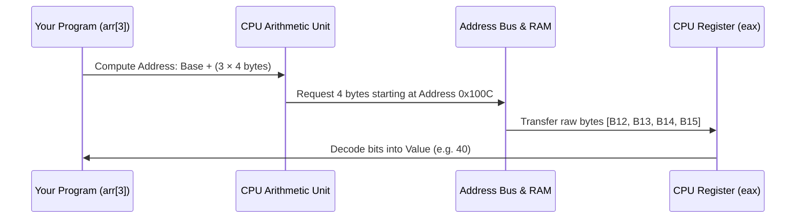

# Address vs. Byte vs. Value: The Trinity of Computer Memory

To truly understand how computer memory operates, we must untangle three terms that are frequently conflated: **The Address**, **The Byte**, and **The Value**.

---

## 1. The Core Mental Model: The Mailbox on the Street

Think of computer memory as a long residential street of identical mailboxes:

```
Address (Coordinate):      #1000          #1001          #1002          #1003
Physical Box (Container): [ 1 Byte ]     [ 1 Byte ]     [ 1 Byte ]     [ 1 Byte ]
Raw Bits (Cargo):        [01000001]     [00000000]     [00000000]     [00000000]
                                 \                                     /
Decoded Value (Meaning):          <------- The integer 65 ------------>
```

| Concept | Real-World Analogy | Physical Machine Reality |
|---|---|---|
| **1. The Address** | **The Street Number** painted on the post (e.g. `#1000`). | A 64-bit numerical coordinate telling the CPU **where** in RAM to look. It has no contents of its own. |
| **2. The Byte** | **The Mailbox container itself**. | The physical, indivisible unit of memory hardware (8 electrical flip-flops/latches holding 8 bits). |
| **3. The Value** | **The letter/package inside** the mailbox. | The actual human meaning (number, text, boolean, pixel) encoded by the bits inside the byte(s). |

---

## 2. Deep Dive into Each Concept

### A. What is a Byte? (The Storage Box)
A **byte** is a physical cluster of **8 bits** ($8$ transistors/capacitors):
$$\text{1 Byte} = \text{[ 0 1 1 0 1 0 0 1 ]}$$

* **Why does memory use bytes instead of bits?**
  A single bit can only represent `0` or `1` (not enough to store a letter, an integer, or an instruction). Modern hardware is **byte-addressable**: the CPU memory controller assigns a unique address to every group of 8 bits, not to individual bits.
* A single byte can store $2^8 = 256$ different bit patterns (numbers from `0` to `255`, or an ASCII character like `'A'`).

### B. What is an Address? (The Coordinate)
An **address** is an unsigned integer that designates a specific byte in RAM.
* **Are addresses written as bytes?**
  * When programmers read or print addresses, we write them in **hexadecimal** (base-16), such as `0x1000` or `0x7ffee4b2a890`. Hexadecimal is used because every hex digit represents exactly 4 bits (so 2 hex digits = 1 byte).
  * In 64-bit hardware, an address itself is a 64-bit number (8 bytes long). If you save an address in a pointer variable (like `&x` in Rust or C), that pointer variable consumes 8 bytes of memory!
* **The Address Bus**: The physical copper wires that carry the address from the CPU to the RAM chips.

### C. What is a Value? (The Content)
The **value** is the data you care about in your program.
* Some values fit in **1 single byte**:
  - A `bool` (`true` = `00000001`)
  - A `u8` integer (`42` = `00101010`)
  - An ASCII character (`'A'` = `01000001`)
* Many values are too large to fit in 1 byte, so they span **multiple consecutive byte mailboxes**:
  - A 32-bit integer (`i32`): requires **4 bytes** (e.g., `#1000, #1001, #1002, #1003`).
  - A 64-bit float (`f64`): requires **8 bytes** (e.g., `#1000` through `#1007`).

---

## 3. How `arr[i]` Turns an Address into a Value

When you execute:
```rust
let x = arr[3];
```

The machine executes this exact sequence:



1. **Calculate the Coordinate (The Address)**:
   $$\text{Address} = \text{Base} + (3 \times 4) = \text{0x100C}$$
2. **Knock on the Door**: The CPU activates the Address Bus wires corresponding to `0x100C`.
3. **Open the Box (Fetch the Bytes)**: The RAM chips place the contents of bytes `0x100C` through `0x100F` onto the Data Bus.
4. **Interpret the Value**: The CPU loads those bytes into a register and treats them as the integer value.

---

## 4. Curated YouTube Video Lessons

To see this animated visually and demonstrated on real circuits and assembly code, these are the best video lessons available on YouTube:

### 1. The High-Level Architecture View
* **Video**: [Crash Course Computer Science #6: Registers and RAM](https://www.youtube.com/watch?v=fpnE6UAfbtU)
  * **Channel**: Crash Course (Hosted by Carrie Anne Philbin)
  * **What it explains**: How individual logic gates and latches store single bits, and how a grid matrix of wires creates **byte addresses**.
* **Video**: [Crash Course Computer Science #7: The Central Processing Unit (CPU)](https://www.youtube.com/watch?v=FZGugFqDr60)
  * **What it explains**: How the CPU's Instruction Register and Address Bus interact to fetch values from memory addresses.

### 2. The Physical Hardware & Breadboard View
* **Video**: [Ben Eater: How computer memory works (8-bit breadboard computer)](https://www.youtube.com/watch?v=Fpm-E5vVqzA)
  * **Channel**: Ben Eater
  * **What it explains**: Ben builds a working RAM module on a breadboard. You physically see him toggle address switches and watch LEDs light up displaying the binary **value** stored at that specific **address**.
* **Video**: [Ben Eater: Building a 6502 computer – Memory and addressing](https://www.youtube.com/watch?v=LnzuMJLZRdU)
  * **What it explains**: The difference between the 16-bit **Address Bus** and the 8-bit **Data Bus**.

### 3. The Systems & Code View (Pointers & Indexing)
* **Video**: [Low Level Learning: Pointers and Memory Addresses Explained](https://www.youtube.com/watch?v=2ybLD6_2gKM)
  * **Channel**: Low Level Learning
  * **What it explains**: Why pointers are just numbers holding an address, how dereferencing works, and why `arr[i]` is identical to `*(arr + i)`.
* **Video**: [Computerphile: Memory & Addressing](https://www.youtube.com/watch?v=p3q5zWCw8J4)
  * **Channel**: Computerphile
  * **What it explains**: Why memory is byte-addressable and how 32-bit and 64-bit systems handle maximum address space.
